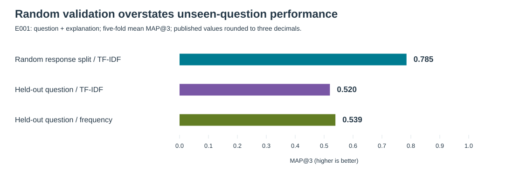

# Responsible AI for Mathematical Misconceptions

**Active research · E001–E010 research checkpoint · Not deployment-ready**

**Research question:** Can mathematical-misconception detection generalize to unseen K–12 math questions, with uncertainty-aware human review?

This independent project tests that question on **36,696 responses to 15 middle-school math questions** from the author-published MAP release. It is a reproducible generalization and selective-prediction study, not a leaderboard solution or evidence of K–12-wide validity.

[Research report](docs/RESEARCH_REPORT.md) · [Experiment index](docs/EXPERIMENT_INDEX.md) · [Reproduce the checks](docs/REPRODUCTION.md) · [Release audit](docs/RELEASE_AUDIT_2026_10.md)

## Main findings



- **Random validation is optimistic.** TF–IDF + logistic regression reaches MAP@3 **0.785** on random response splits but **0.520** on held-out questions, below the **0.539** frequency baseline. Frozen MiniLM embeddings also fail to beat frequency.
- **Unavailable labels explain only part of the difficulty.** 21.1% of held-question responses have an exact label absent from training. Even among supported labels, TF–IDF MAP@3 is **0.668**, versus **0.689** for frequency.
- **Better ranking does not establish reliable automation.** E009's learned reliability score improves explanation-only correctness AUROC to **0.695**, but no admissible development cutoff meets the registered per-question requirements. All cases are deferred.
- **Review prioritization remains a negative primary result.** At E010's 20% review budget, learned routing improves on support-aware routing by **1.387 ± 0.828** fewer remaining errors per 100 responses for explanation-only and **0.279 ± 1.098** for question + explanation. Neither meets the preregistered criterion. Retained error rates remain **59.3%** and **58.8%**.

Means and sample SDs describe five folds, not independent inferential evidence. Deferred errors are **not** assumed corrected by a human. Both input arms, all registered budgets, all questions and negative results remain published.

## What this repository contributes

Frozen question-held-out evaluation; nested model selection; group-disjoint calibration; exact-label support diagnostics; comparison of confidence, support-aware and cross-fitted reliability routing; simulated fixed-budget review; and an auditable history of negative results. It does **not** introduce a new classifier architecture or claim priority for unseen-question diagnosis or selective prediction. See the [literature and interpretation review](docs/RESEARCH_REVIEW_2026_09.md).

## Verify without student data

Requires Git and Docker with Linux containers. The verification environment is CPU-only, Linux amd64, non-root and hash-locked. Run from a checkout root:

```powershell
docker build --platform linux/amd64 --pull --no-cache -t map-research-verify:2026-10 -f repro/Dockerfile repro
docker run --rm --network none --read-only --tmpfs /tmp:rw,nosuid,nodev --user 10001:10001 --cap-drop ALL --security-opt no-new-privileges --mount "type=bind,source=$($PWD.Path),target=/workspace,readonly" map-research-verify:2026-10
```

This runs synthetic regression tests, historical-preservation checks, public aggregate validators and deterministic figure checks. It does **not** download MAP, fit research models or reproduce their predictions. [Detailed commands and modeling-reproduction limits](docs/REPRODUCTION.md).

CI applies publication checks to the public checkout and runs the same offline verification. The original modeling Dockerfile, dependencies and experiment launchers remain unchanged; they are not a fully hash-locked fresh reproduction of every historical model.

## Research history and limitations

Start with the [experiment index](docs/EXPERIMENT_INDEX.md), then follow each protocol, execution record and complete result table. The [experiment log](docs/EXPERIMENT_LOG.md) is append-only. E001–E010 scientific records are preserved by a [checksum inventory](repro/history.json).

Only 15 questions underpin this repeatedly examined benchmark. Calibration-question roles differ between E006 and E007 onward. E004/E005 were archived retrospectively, not publicly preregistered in Git before execution, and have incomplete secondary reporting. A [Brier-score erratum](docs/METRIC_ERRATUM_2026_09.md) corrects a legacy unseen-label bug without rewriting the old results. These limits are part of the findings, not hidden exceptions.

No new experiment is running. Future modeling needs a separately registered question and protocol. Terminal monitoring is used only during active runs, with at-most-hourly progress updates; no idle monitor is scheduled.

## Data, privacy and citation

Data provenance and the author-release license are recorded in [DATA_AND_LICENSES.md](docs/DATA_AND_LICENSES.md). Obtain data only from that author-published source; the closed competition and unrelated reuploads are not substitutes. The repository includes **no raw student responses, dataset archives, row-level predictions, fitted models or credentials**. Raw data and local artifacts stay ignored. The repository's MIT code license does not relicense third-party data.

Repository citation metadata is in [CITATION.cff](CITATION.cff). Also cite [Rittle-Johnson et al., *Detecting Math Misconceptions: An AI Benchmark Dataset* (2025)](https://aclanthology.org/2025.aimecon-wip.3/) and the author-published release when using MAP. This project is not affiliated with Eedi, Vanderbilt University, The Learning Agency or Kaggle.
