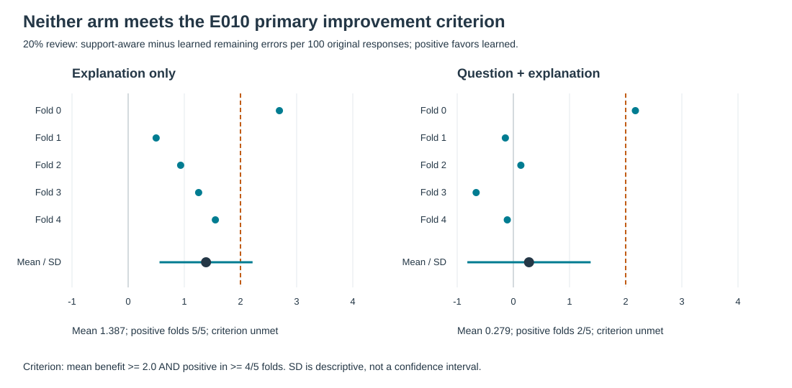
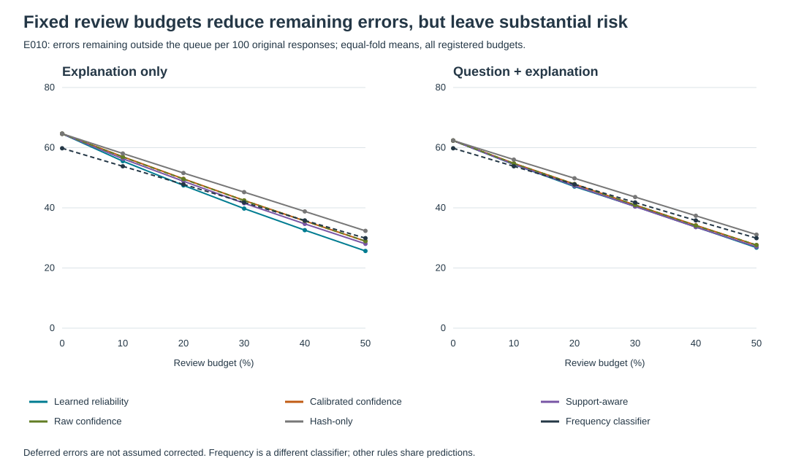
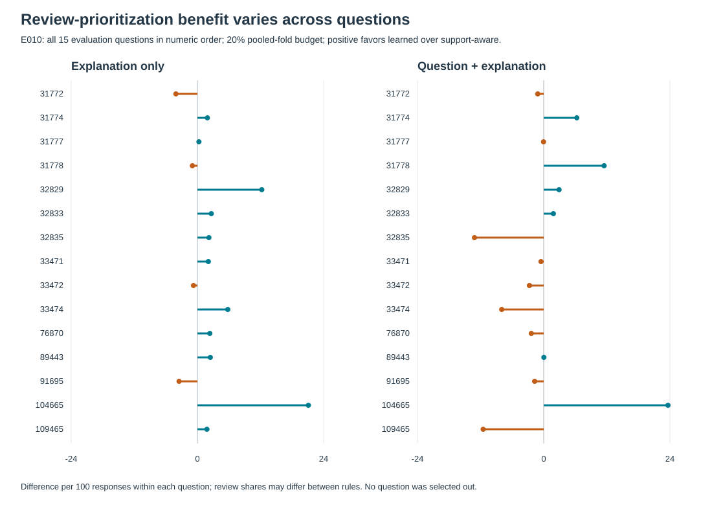

# Generalization and human-review routing for mathematical misconception detection

Research checkpoint, 13 October 2026. Active research; not a deployment recommendation.

## Summary

The tested models do not establish reliable exact-misconception detection on unseen questions. Random-split performance substantially overstates held-question performance; neither lexical nor frozen semantic baselines surpass a frequency reference. Label unavailability contributes to the difficulty but does not account for all of it. A learned reliability score improves error ranking, especially for explanation-only predictions, without producing an admissible automation policy or meeting the subsequent fixed-review-budget improvement criterion.

The contribution is a reproducible evaluation and evidence package, not a new architecture. E001–E010, their negative results, original protocols and historical discrepancies remain unchanged. This synthesis adds no model fitting, threshold search, subgroup selection or inferential test. [Experiment index](EXPERIMENT_INDEX.md)

## Research question and data

The research question is **generalization of mathematical-misconception detection to unseen K–12 math questions, with uncertainty-aware human review**. The available evidence is narrower: 36,696 responses to 15 middle-school questions from the separately published MAP author release. The exact target is `Category:Misconception`; six-way Category evaluation in E005 marginalizes the exact-label probabilities rather than fitting a new category classifier.

The MAP paper describes a larger expert-coded corpus and item-specific rubrics. Its full-corpus authentic/synthetic composition cannot be assigned to this smaller release because row-level origin is unavailable. The project also lacks demographics and cannot establish demographic fairness. Acquisition provenance, the displayed author-release MIT license and the distinct closed-competition terms are preserved in the [data register](DATA_AND_LICENSES.md). No raw response text is published. [Rittle-Johnson et al., 2025](https://aclanthology.org/2025.aimecon-wip.3/)

## Evaluation and comparability

Five frozen outer folds hold out whole `QuestionId` groups. Hyperparameter selection uses only the appropriate outer training portion, with fold-local text processing. The random-response reference allows the same questions in training and evaluation and is not an unseen-question estimate. Both explanation-only and question-plus-explanation arms are reported without selecting a winner after evaluation.

| Experiment family | Question roles and purpose | Comparison boundary |
|---|---|---|
| E001–E006 grouped classification | Nine training, three temperature-calibration, three evaluation questions | Label support depends on training roles; E004 changes representation |
| E007 fixed cutoffs | Nine training, one temperature, two cutoff-development, three evaluation | Same outer evaluation groups; calibration differs from E006 |
| E008 feasibility | E007 development roles only | Exploratory diagnosis; no outer-evaluation predictions |
| E009 learned reliability | E007 roles; nested 3/3/3 cross-fitting within nine training questions | Final classifier unchanged; error-ranking learner added |
| E010 fixed review budgets | Reconstructs E009 and requires reference outputs to match | Changes the routing question, not E009's negative threshold result |

E009's reliability learner uses maximum raw probability, raw probability margin, normalized entropy, predicted-label training support and maximum training TF–IDF similarity. Each inner classifier is tuned independently on its own training questions. E010 freezes all label-blind batch routing masks before evaluation correctness is exposed. Neither true-label support nor held-out labels enter a routing policy.

MAP@3 summarizes the correct exact label's rank among three candidates; top-1 risk is one minus accuracy on retained predictions. ECE and Brier describe probability quality, while correctness AUROC measures ranking of correct versus incorrect predictions. These are different objectives. Temperature scaling does not itself certify calibration under new-question shift. [Guo et al., 2017](https://proceedings.mlr.press/v70/guo17a.html)

Results use equal-weight means across five folds, with sample SD where shown. Fold training sets overlap; fold variation, E005 bootstrap intervals and its 15-question permutation summaries are descriptive only. No new confidence intervals or significance claims are added.

## Classification fails the held-question stress test

| Evaluation / model | Explanation-only MAP@3 | Question + explanation MAP@3 |
|---|---:|---:|
| E001 random / TF–IDF + logistic | 0.764 | 0.785 |
| E001 held-question / TF–IDF + logistic | 0.497 | 0.520 |
| Held-question / frequency | 0.539 | 0.539 |
| E004 held-question / frozen MiniLM + logistic | 0.476 | 0.464 |
| E003 supported labels / TF–IDF + logistic | 0.640 | 0.668 |
| E003 supported labels / frequency | 0.689 | 0.689 |

Values are rounded from [E001](E001_RESULTS.md), [E003](E003_RESULTS.md) and [E004](E004_RESULTS_ARCHIVE.md). Supported-label evaluation is a diagnostic subset, not a replacement primary task. Frequency's duplicated input arms are the same reference, not independent evidence.

E005 counts 7,755 evaluation responses with labels absent from training, zero with 1–19 training examples, and 28,941 with at least 20. Of the last group, 28,187 are well-supported: at least 20 examples across at least two training questions. Unsupported labels cannot be correctly predicted by these closed-set classifiers. An empty rare stratum supplies no evidence about rare-label behavior.

Restricting evaluation to well-supported labels does not remove the random-to-grouped collapse. Question-plus-explanation TF–IDF MAP@3 falls from 0.798213 to 0.684162, a difference of 0.114051, compared with 0.265392 overall. The random and grouped subsets differ in membership; this is not a matched-row causal decomposition. Grouped frequency still obtains 0.706722 on the well-supported subset. [E005 archive](E005_RESULTS_ARCHIVE.md)

Coarsening the target is not an automatic solution. Six-way Category accuracy is 0.3600 for explanation-only and 0.3797 for question + explanation, versus 0.4020 for frequency. The learned models have higher reported Category macro-F1 (0.2075 and 0.1855 versus 0.0953), so the metrics do not yield a blanket statement that Category never transfers. Those legacy macro-F1 values use the observed truth/prediction label union, not an explicitly fixed six-label list. [E005 archive](E005_RESULTS_ARCHIVE.md)

The results do not isolate a single failure mechanism. Question-conditioned mathematical reasoning, item-specific label semantics and annotation ambiguity remain hypotheses. Neither input arm includes `MC_Answer`; E004 lacks truncation diagnostics. Failure of one frozen encoder does not establish that semantic representations or mathematical reasoning models generally fail. [Historical audit](REPRODUCIBILITY_AUDIT_2026_09.md)

## Selective prediction does not establish reliable automation

At 50% review, E006's question-plus-explanation support-aware rule retains accuracy 0.4581, MAP@3 0.5710 and risk 0.5419, compared with frequency's accuracy 0.4017 and risk 0.5983. All four learned routing pairs meet the registered relative-improvement criterion, but more than half of retained predictions can still be wrong. That criterion was not an absolute safety requirement. [E006 results](E006_RESULTS.md)

E007 selects a fixed cutoff using two development questions, with minimum count and coverage requirements and an error target enforced separately for each. At the primary 20% target, and secondary 10% and 30% targets, every arm/rule returns no admissible cutoff. Evaluation coverage is zero and retained risk is undefined, **not zero**. This is failure to find a qualifying development policy, not a measurement of nonempty-policy transfer. [E007 results](E007_RESULTS.md)

E008's development-only diagnosis assigns every primary-target case to a score-selection limitation rather than a fixed-prediction limit or common-cutoff incompatibility. A correctness oracle can identify a low-risk subset, but uses unavailable outcome information. Its feasibility does not show that prediction-time features can learn the subset. [E008 results](E008_RESULTS.md)

E009 tests that distinction with a cross-fitted correctness learner. Explanation-only correctness AUROC rises to 0.6945 ± 0.0578, compared with 0.6058 ± 0.0203 for calibrated confidence and 0.6397 ± 0.0159 for support-aware scores. Question-plus-explanation learned AUROC is 0.6338 ± 0.0362, versus 0.6099 ± 0.0210 and 0.6276 ± 0.0292 respectively. All fixed-cutoff policies nevertheless defer everything. Better global ranking does not establish a sufficiently accurate retained tail on every development question. [E009 results](E009_RESULTS.md)

Support-aware scoring weights a prediction by the training frequency of its **predicted** label. It does not detect whether the unknown true label is unsupported: a confidently wrong common-label prediction can score highly. True-label strata remain after-the-fact diagnostics, not routing inputs.

## Fixed-budget review misses the meaningful-gain criterion

E010 asks whether learned reliability routes more existing classifier errors to a fixed-capacity review queue than support-aware ranking. Its primary criterion is at least two fewer remaining errors per 100 original responses on average at 20% review, with positive benefit in at least four of five folds, separately per arm.

| Primary 20% review result | Explanation only | Question + explanation |
|---|---:|---:|
| Benefit versus support-aware, mean ± SD | 1.3868 ± 0.8285 | 0.2786 ± 1.0979 |
| Positive folds | 5 / 5 | 2 / 5 |
| Registered criterion | Unmet | Unmet |
| Learned retained top-1 risk | 0.5932 | 0.5884 |
| Learned retained MAP@3 | 0.5351 | 0.5411 |
| Learned retained classifier ECE | 0.1581 | 0.1763 |
| Learned retained union-label Brier | 0.8191 | 0.8203 |

The explanation-only benefit is directionally consistent across folds but below the fixed meaningful-gain margin. The question-plus-explanation gain is small and inconsistent. Neither another budget nor AUROC replaces the unmet primary criterion. The margin is a preregistered research choice, not an educational safety standard.

The curves show remaining errors **per 100 original responses**: increasing review mechanically removes more cases from that denominator's error count. This differs from demonstrating lower error rates among retained predictions. Frequency uses different predictions; hash-only, raw confidence, calibrated confidence, support-aware and learned reliability share the learned classifier's predictions.

The 20% budget applies to each fold's pooled evaluation batch, not separately to each question. Rules may assign different review shares to a question. The per-question figure therefore describes pooled-batch routing, not equal per-question capacity. The full [E010 report](E010_RESULTS.md) and [JSON](../results/E010_aggregates.json) retain denominators, review shares, support strata and calibration eligibility. No human corrections, teacher time savings or student benefits have been measured.

## Relationship to prior work

Unseen-question misconception transfer predates this project. Kolb, Farrar and Pardos evaluate expert-diagnosis generalization across held-out raters, topics and questions using question-answer embeddings and logistic regression. Their task differs from MAP exact-label classification, but rules out broad algorithmic-priority claims here. [Kolb et al., EDM 2019](https://files.eric.ed.gov/fulltext/ED599212.pdf)

Selective question answering under domain shift already studies correctness calibration beyond maximum probability, while broader NLP comparisons find no selection method consistently superior across settings. These negative findings extend that evaluation concern to this particular small MAP benchmark, not to every shifted task. [Kamath et al., ACL 2020](https://aclanthology.org/2020.acl-main.503/), [Varshney et al., Findings ACL 2022](https://aclanthology.org/2022.findings-acl.158/)

The [September narrative review](RESEARCH_REVIEW_2026_09.md) records search scope and further references. It was not an exhaustive systematic review. Central primary references above were rechecked for this synthesis; this checkpoint does not claim a new exhaustive novelty search.

## Limitations and research status

1. **Few independent questions and repeated examination.** Fifteen questions do not establish transfer across curricula, grades, schools or authentic-only responses. Later choices are informed by earlier results on the same benchmark; preregistration does not create a fresh external test.
2. **Historical reporting gaps.** E004/E005 were published retrospectively. E004 lacks some secondary outputs; E005 applies calibration eligibility foldwise despite a pooled protocol description and lacks several promised interval summaries. Its random inner-seed discrepancy leaves intermediate equivalence unproven despite matching checked scalar outputs. These gaps remain disclosed, not retroactively filled.
3. **Metric correction.** Legacy Brier omitted the unseen true-label coordinate. Proper grouped frequency Brier is 0.795057 rather than 0.581666; MAP@3, accuracy and ECE are unaffected. Newer selective experiments use corrected Brier. [Erratum](METRIC_ERRATUM_2026_09.md)
4. **Calibration is conditional and imperfect.** The historical temperature fit excludes unsupported calibration labels. Eligible-stratum reporting is not a reliability guarantee; ineligible or empty groups are not evidence of zero risk. Reliability-head and classifier calibration have different targets.
5. **Reproducibility has levels.** Fresh hash-locked verification checks synthetic tests and public aggregates without MAP. It is not a fresh execution of all experiments; the original full modeling dependency closure remains incompletely locked. [Reproduction guide](REPRODUCTION.md)

On these frozen held-question splits, classification quality and useful error ranking are insufficient evidence for dependable exact-label automation; the tested fixed-budget router also misses its meaningful-improvement criterion. Further modeling would require a new registered hypothesis and, for stronger generalization claims, genuinely new evaluation evidence. No E011 is proposed or run in this checkpoint.
